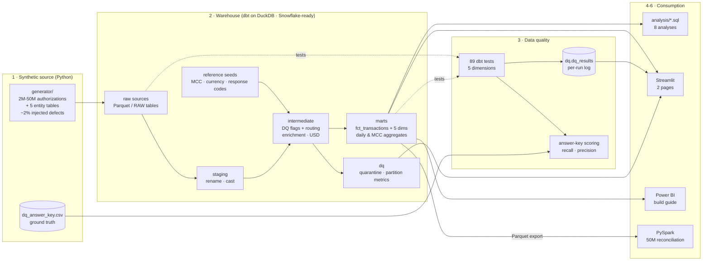
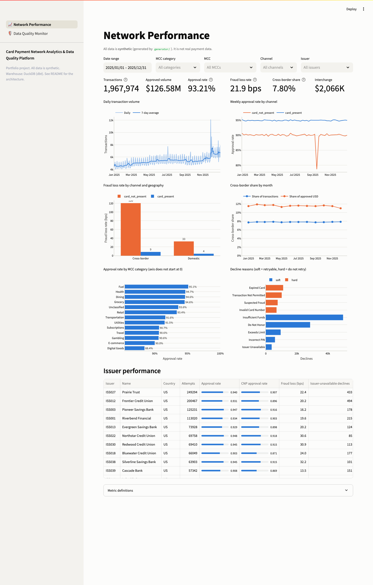
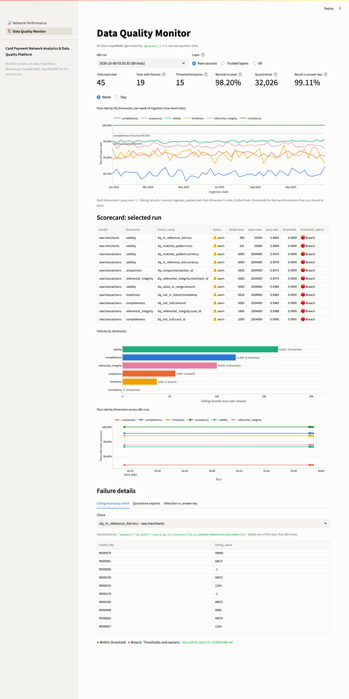

# Card Payment Network Analytics & Data Quality Platform

An end-to-end analytics platform for a **card payment network's authorization data**:
synthetic data generation, a governed dbt warehouse (DuckDB locally, Snowflake-ready),
five-dimension data-quality monitoring scored against ground truth, business analysis in SQL,
a Streamlit dashboard with a Power BI build guide, and a PySpark scale test to 50M rows.

> **Personal portfolio project. All data is synthetic**, produced by the generator in this repo.
> No real cardholder, merchant, issuer or network data is used. Issuer and acquirer names are
> fictional, and interchange rates are illustrative. Several business patterns were deliberately
> planted so the analytics could be validated; they are disclosed in [DECISIONS.md](DECISIONS.md) (D-14).

---

## Business context

On every card swipe or online checkout, an **authorization request** travels from the merchant
through its **acquirer** and the **card network** to the **issuer**, which approves or declines in
milliseconds. A network operator watches this flow for:

- **Authorization performance**: approval rates, decline reasons, issuer outages (false declines cost sales).
- **Risk**: fraud by channel (card-present vs. card-not-present) and geography, card-testing attacks, chargeback-heavy merchants.
- **Economics**: interchange by card product, regulated vs. exempt debit, merchant category.
- **Data trust**: none of the above is credible if duplicates, broken references or malformed codes leak into the numbers.

This project builds that monitoring stack end to end, with the same layering, controls and
documentation a network analytics team would use.

## Architecture



The full model-level lineage graph is in [docs/LINEAGE.md](docs/LINEAGE.md); `make docs` gives the interactive version.

## What's inside

| Stage | What | Where |
|---|---|---|
| 1. Data | Reproducible generator (fixed seed, chunked to 50M): seasonality, holidays, 18 real MCCs, CNP and cross-border fraud uplift, ISO 8583 decline codes, illustrative interchange incl. Reg II debit. About 2.1% defects across 7 types, each logged in an answer key. | `generator/` |
| 2. Warehouse | dbt: staging -> intermediate -> marts star schema; incremental fact; 100% of 283 columns carry business definitions; Snowflake target, setup and `COPY INTO` scripts | `dbt/`, `snowflake/`, [SNOWFLAKE_SETUP](docs/SNOWFLAKE_SETUP.md) |
| 3. Data quality | 11 custom generic tests (completeness, uniqueness, validity, timeliness, referential integrity + consistency), results logged per run to `dq_results`, scored against ground truth | `dbt/tests/generic/`, `dq/`, [SCORECARD](docs/DATA_QUALITY_SCORECARD.md) |
| 4. Analysis | 8 SQL analyses (window functions, CTEs, MoM, cohorts, robust anomaly baselines) + 5 insights with recommendations | `analysis/`, [INSIGHTS](docs/INSIGHTS.md) |
| 5. Dashboard | Streamlit: Network Performance + Data Quality Monitor; Power BI star schema + 30 DAX measures | `dashboard/`, [POWERBI_GUIDE](docs/POWERBI_GUIDE.md) |
| 6. Spark | PySpark ports of the 3 heaviest analyses, reconciled row by row with DuckDB at 2M and 50M rows; partitioning, shuffle and lazy-evaluation experiments | `spark/`, [SPARK_NOTES](docs/SPARK_NOTES.md) |

## Key results

**Data quality (2M rows, 41,900 injected defects)**
- **99.11% recall, 100% precision.** Every injected null, duplicate, negative amount, malformed currency, invalid MCC and orphan key was caught; no false positives.
- The 374 misses are all future timestamps 1-4 minutes ahead of ingestion, inside a deliberate 5-minute clock-skew tolerance. The report explains every miss and includes a grace-window sensitivity table.
- Format checks alone miss 99 of 300 invalid MCCs (`0000` is well-formed); reference-list checks catch all 300.
- Bad records never reach BI: they are repaired (6,800), quarantined with a remediation owner (32,026), or dropped as replays (4,000), and 44/44 trusted-layer tests pass.

**Business insights** (details in [docs/INSIGHTS.md](docs/INSIGHTS.md))
1. **Card-not-present is 40% of volume but 87% of fraud losses**; cross-border CNP carries 35x the fraud attempt rate of domestic card-present.
2. A **card-testing attack** on one payment facilitator's merchants was detected on all 3 days with a trailing-median baseline (a mean/stddev baseline missed days 2-3). 444 stolen cards were validated, and the recommendation is to alert their issuers.
3. One issuer's **CNP approval is 11 points below peers** with no fraud benefit, indicating likely false declines worth about 1,090 lost sales per year.
4. A 3-hour **issuer outage** (code 91) was found with a gaps-and-islands query, which makes the case for stand-in processing.
5. **Regulated debit is 21% of volume but 5% of interchange**, which shapes where a network competes for issuer portfolios.

**Scale (49.2M-row fact)**: three PySpark jobs reproduce the DuckDB results **exactly**. On one
laptop DuckDB is still 2-5x faster than Spark local mode. [SPARK_NOTES](docs/SPARK_NOTES.md)
explains why, and when Spark is the right tool anyway.

## Dashboard

| Network Performance | Data Quality Monitor |
|---|---|
|  |  |

Screenshots: `docs/images/` (regenerate after `make dashboard`).

## Quickstart

**Prerequisites:** Python 3.10+ (tested on 3.11), about 2 GB free disk. Java 11/17 is needed only for the PySpark step.

```bash
git clone <this repo> && cd <repo>
./run_all.sh          # venv + deps -> 2M rows -> dbt build -> DQ report -> analyses -> Spark -> tests
make dashboard        # http://localhost:8501
make docs             # dbt docs + lineage graph on http://localhost:8080
```

Other entry points (`make help` lists all targets):

```bash
ROWS=500000 ./run_all.sh     # quicker run
SKIP_SPARK=1 ./run_all.sh    # no Java available
make spark-50m               # 50M-row scale test (about 15-20 min)
DBT_TARGET=snowflake ...     # see docs/SNOWFLAKE_SETUP.md
```

What `run_all.sh` verifies on the way: `dbt build` (raw tests **warn** where defects were
injected, trusted-layer tests must **pass**), 100% column-documentation coverage, the
answer-key expectations (exit code 1 if any fails), Spark-vs-DuckDB reconciliation, and the pytest
suite (generator determinism, business rules, DQ mapping, Spark parity, dashboard smoke tests).

## Technology choices

| Choice | Why |
|---|---|
| **dbt** | Version-controlled SQL transformations with tests, documentation and lineage as first-class artifacts. That is how metadata and business definitions are governed. |
| **DuckDB** (default) | Zero-cost, zero-setup analytical warehouse that runs the whole project on a laptop and reads Parquet in place. |
| **Snowflake** (target) | The production-grade path: same models, `adapter.dispatch` for dialect differences, clustering on the fact. Setup, roles and `COPY INTO` scripts included. |
| **Synthetic data with an answer key** | Real payment data is unavailable. Planted defects and scenarios give ground truth, so data-quality checks and analyses can be *measured*, not just run. |
| **Streamlit + Plotly** | A dashboard that runs from the repo with no license. The Power BI guide covers the enterprise BI path. |
| **PySpark** | Shows the distributed-compute model and proves logic portability through exact reconciliation. |
| **Parquet** | Columnar, compressed, readable by DuckDB, Spark, Snowflake and Power BI alike. |

Every non-obvious call (50 decisions) is logged with its rationale in [DECISIONS.md](DECISIONS.md).

## Repository layout

```
generator/          synthetic data generator + defect injection
dbt/                dbt project (models, seeds, generic tests, macros, profiles for DuckDB & Snowflake)
snowflake/          Snowflake setup + PUT / COPY INTO load scripts
dq/                 answer-key scoring script + generated detection report
analysis/           8 business analyses (+ results/*.csv) and 15 interview SQL questions (interview/)
dashboard/          Streamlit app (2 pages) + data access layer
spark/              PySpark jobs, reconciliation, experiments, benchmark results
scripts/            seeds export, lineage export, doc coverage, marts export, 50M runner
tests/              pytest suite
docs/               scorecard, insights, Snowflake / Power BI guides, Spark notes, lineage, screenshots
run_all.sh, Makefile
```

## Documentation index

- [docs/INSIGHTS.md](docs/INSIGHTS.md): five insights with evidence and recommendations
- [docs/DATA_QUALITY_SCORECARD.md](docs/DATA_QUALITY_SCORECARD.md): DQ metrics, thresholds, routing, ownership
- [dq/reports/detection_report.md](dq/reports/detection_report.md): latest recall / precision report
- [docs/LINEAGE.md](docs/LINEAGE.md): model lineage (Mermaid)
- [docs/SNOWFLAKE_SETUP.md](docs/SNOWFLAKE_SETUP.md): run the warehouse on Snowflake
- [docs/POWERBI_GUIDE.md](docs/POWERBI_GUIDE.md): rebuild the dashboard in Power BI
- [docs/SPARK_NOTES.md](docs/SPARK_NOTES.md): scale test, partitioning, shuffle, lazy evaluation
- [DECISIONS.md](DECISIONS.md): design decisions and assumptions

## Limitations

- Synthetic data: distributions are plausible, not calibrated to any real network. Planted scenarios make the "findings" partly known in advance; the value is in the detection and quantification methods.
- Only the authorization layer is modelled (no clearing / settlement, no real-time streaming).
- Static FX rates and illustrative interchange.
- The Snowflake path is compiled and syntax-validated, but must be run with your own account (see the setup guide).
