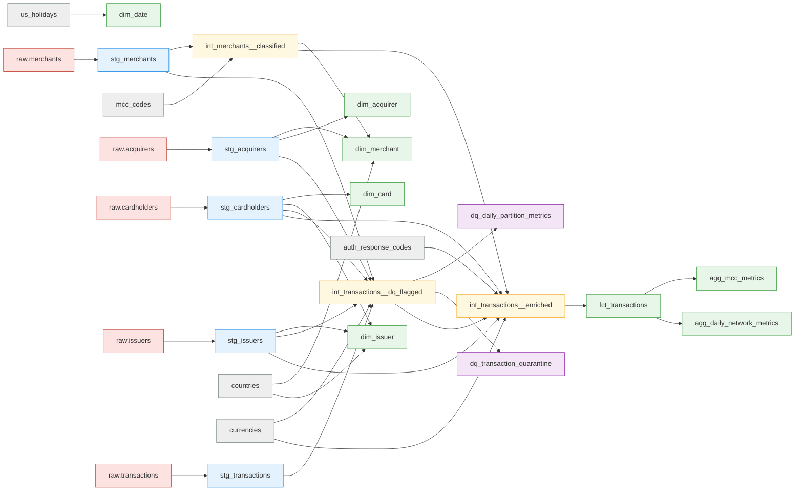

# Data Lineage

Auto-generated from `dbt/target/manifest.json` by `scripts/export_lineage.py`. For the interactive
version with column-level documentation run `make docs` (dbt docs serve).

Colour key: red = raw sources, grey = reference seeds, blue = staging, yellow = intermediate,
purple = data quality, green = marts.

